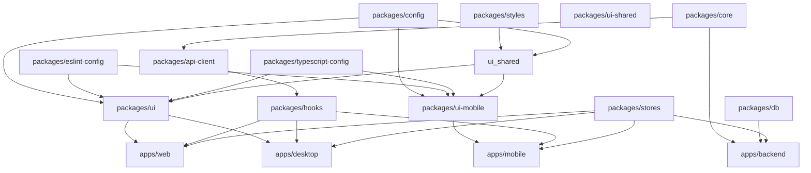

# Monorepo Structure

**Turborepo monorepo architecture for ORDO with Hybrid UI Strategy**

## 📋 Table of Contents

1. [What is Turborepo?](#what-is-turborepo)
2. [Directory Structure](#directory-structure)
3. [UI Architecture Strategy](#ui-architecture-strategy)
4. [Workspace Protocol](#workspace-protocol)
5. [Build Caching](#build-caching)
6. [Task Orchestration](#task-orchestration)
7. [Dependency Management](#dependency-management)
8. [Package Dependencies](#package-dependencies)

---

## 🚀 What is Turborepo?

Turborepo is a build system for JavaScript/TypeScript monorepos. It provides:

- **Build Caching**: Cache build artifacts across machines
- **Task Orchestration**: Run tasks in topological order
- **Remote Caching**: Share cache across team members
- **Incremental Builds**: Only rebuild changed packages

### Why Turborepo for ORDO?

- **Code Sharing**: Share domain logic, UI logic, and design tokens across platforms
- **Consistent Builds**: Same build process for all packages
- **Faster CI/CD**: Parallel builds with caching
- **Type Safety**: Shared types across monorepo

---

## 📁 Directory Structure

```
ordo-creators/
│
├── apps/                          # Platform-specific applications
│   ├── backend/                   # NestJS REST API
│   ├── web/                       # Next.js 16 web app
│   ├── mobile/                    # React Native + Expo
│   └── desktop/                   # Electron
│
└── packages/                      # Shared packages
    ├── core/                      # Domain logic (DDD)
    ├── db/                        # Database (Prisma)
    ├── styles/                    # ✅ Design Tokens (Single Source of Truth)
    ├── ui-shared/                 # ✅ Shared UI Logic (No primitives)
    ├── ui/                        # ✅ Web/Desktop UI (Radix + Tailwind)
    ├── ui-mobile/                 # ✅ Mobile UI (React Native + NativeWind)
    ├── hooks/                     # React Query Hooks
    ├── stores/                    # Zustand Stores
    ├── api-client/                # REST API Client
    ├── i18n/                      # Translations
    ├── config/                    # Shared configs
    ├── eslint-config/             # ESLint Configuration
    └── typescript-config/         # TypeScript Configuration
```

### UI Package Breakdown

**NEW ARCHITECTURE (Hybrid Strategy):**

```
packages/
├── styles/               # Design Tokens ONLY
│   ├── src/
│   │   ├── tokens.ts    # Colors, spacing, typography, radii
│   │   ├── theme.ts     # Theme definitions
│   │   └── index.ts
│   └── package.json
│
├── ui-shared/            # UI Logic ONLY (No primitives)
│   ├── src/
│   │   ├── types/      # Shared component types
│   │   ├── hooks/      # Shared UI hooks (useHover, etc.)
│   │   ├── utils/      # CVA configs, accessibility logic
│   │   └── index.ts
│   └── package.json
│
├── ui/                  # Web/Desktop UI (Radix + Tailwind v4)
│   ├── src/
│   │   ├── components/
│   │   │   ├── primitives/    # Button, Input, Card (Web)
│   │   │   ├── composition/   # Dialog, Menu, Tooltip (Radix)
│   │   │   ├── content/       # Content-specific components
│   │   │   └── index.ts
│   │   └── lib/
│   │       └── cn.ts         # Class name utility
│   └── package.json
│
└── ui-mobile/            # Mobile UI (React Native + NativeWind v4)
    ├── src/
    │   ├── components/
    │   │   ├── primitives/    # Button, Input, Card (Native)
    │   │   ├── composition/   # Dialog, Modal (Native)
    │   │   ├── content/       # Content-specific components
    │   │   └── index.ts
    │   └── lib/
    │       └── cn.ts         # Style utility
    └── package.json
```

---

## 🎨 UI Architecture Strategy

ORDO uses a **hybrid UI architecture** with 3 layers:

### Layer 1: Design Tokens (`@ordo-todo/styles`)

**Purpose:** Single source of truth for design tokens

**Contains:**

- Colors (primary, danger, neutral)
- Spacing (xs, sm, md, lg, xl)
- Radii (rounded corners)
- Typography (font families, sizes, weights)
- Shadows, z-index, etc.

**NO:** Components, logic, dependencies

```typescript
// packages/styles/src/tokens.ts
export const colors = {
  primary: {
    50: "#e6fffa",
    500: "#06b6d4",
    700: "#0891b2",
  },
  bg: {
    DEFAULT: "#0b1020",
    surface: "#0f1724",
  },
};

export const spacing = {
  xs: 4,
  sm: 8,
  md: 16,
  lg: 24,
  xl: 32,
};
```

### Layer 2: UI Logic (`@ordo-todo/ui-shared`)

**Purpose:** Shared UI logic without platform primitives

**Contains:**

- Component types (ButtonProps, InputProps, etc.)
- Shared hooks (useHover, useFocus, usePress)
- CVA configs (variant definitions)
- Accessibility utilities (ARIA helpers)
- Platform detection utilities

**NO:** DOM primitives, RN primitives, components

```typescript
// packages/ui-shared/src/types/button.ts
export interface ButtonProps {
  title?: string;
  children?: React.ReactNode;
  variant?: "primary" | "ghost" | "danger";
  size?: "sm" | "md" | "lg";
  disabled?: boolean;
  onClick?: () => void; // Web
  onPress?: () => void; // Mobile
  className?: string; // Web
  style?: object; // Mobile
}
```

### Layer 3: Platform-Specific UI

**Web/Desktop (`@ordo-todo/ui`):**

- Radix UI primitives (Dialog, Menu, Tooltip)
- TailwindCSS v4 classes
- CVA for variants
- Web-specific features

**Mobile (`@ordo-todo/ui-mobile`):**

- React Native primitives
- NativeWind v4 (Tailwind-like classes)
- Native-specific features (Modal, ActionSheet)

---

## 🔗 Workspace Protocol

Turborepo uses workspace protocol for internal dependencies.

### In package.json

```json
{
  "name": "@ordo-todo/web",
  "dependencies": {
    "@ordo-todo/core": "workspace:*",
    "@ordo-todo/styles": "workspace:*",
    "@ordo-todo/ui-shared": "workspace:*",
    "@ordo-todo/ui": "workspace:*",
    "@ordo-todo/hooks": "workspace:*",
    "@ordo-todo/stores": "workspace:*",
    "@ordo-todo/api-client": "workspace:*"
  }
}
```

```json
{
  "name": "@ordo-todo/mobile",
  "dependencies": {
    "@ordo-todo/core": "workspace:*",
    "@ordo-todo/styles": "workspace:*",
    "@ordo-todo/ui-shared": "workspace:*",
    "@ordo-todo/ui-mobile": "workspace:*",
    "@ordo-todo/hooks": "workspace:*",
    "@ordo-todo/stores": "workspace:*",
    "@ordo-todo/api-client": "workspace:*"
  }
}
```

### In Code

```typescript
// ✅ CORRECT: Use workspace protocol
import { Button } from "@ordo-todo/ui"; // Web
import { Button } from "@ordo-todo/ui-mobile"; // Mobile
import { colors, spacing } from "@ordo-todo/styles";
import { ButtonProps } from "@ordo-todo/ui-shared";

// ❌ WRONG: Relative imports
import { Button } from "../../../ui/src/components/primitives/button";
```

---

## 💾 Build Caching

Turborepo caches build artifacts to speed up rebuilds.

### Cache Keys

Cache key is based on:

- File contents (hash)
- Environment variables
- Command arguments
- Tool versions

### Example

```bash
# First build (slow)
npm run build
# Output: Building backend, web, mobile, desktop...

# Second build (fast, unchanged)
npm run build
# Output: Cache hit for backend, web, mobile, desktop...

# After changing one package
echo "// changed" >> packages/core/src/index.ts

npm run build
# Output: Cache miss for core, cache hit for others
# Building core → ui → web → backend...
```

---

## 🔄 Task Orchestration

Turborepo runs tasks in topological order based on dependencies.

### Dependency Graph (NEW)

```
styles ────────┐
               ├──► ui-shared ──────┐
config ────────┤                  ├──► ui ──────► web
eslint-config ──┤                  ├──► ui-mobile ──► mobile
typescript-config─┤                  └─────────────────► desktop
               ├──► hooks ────────────────────►
               │                               ├──► backend
core ─────────────┤                               │
               ├──► stores ────────────────────────┘
db ──────────────┘
               │
               └──► api-client
```

### Example: Build Task

**turbo.json**

```json
{
  "pipeline": {
    "build": {
      "dependsOn": ["^build"],
      "outputs": ["dist/**", ".expo/**"]
    }
  }
}
```

**Execution Order:**

1. `packages/styles` (no dependencies)
2. `packages/config` (no dependencies)
3. `packages/eslint-config` (no dependencies)
4. `packages/typescript-config` (no dependencies)
5. `packages/core` (no dependencies)
6. `packages/db` (no dependencies)
7. `packages/ui-shared` (depends on styles, config)
8. `packages/ui` (depends on ui-shared, styles, config)
9. `packages/ui-mobile` (depends on ui-shared, styles, config)
10. `packages/hooks` (depends on api-client, core)
11. `packages/stores` (no dependencies)
12. `packages/api-client` (depends on core)
13. `apps/web` (depends on ui, hooks, stores)
14. `apps/mobile` (depends on ui-mobile, hooks, stores)
15. `apps/backend` (depends on core, db)
16. `apps/desktop` (depends on ui, hooks, stores)

---

## 📦 Dependency Management

### Adding a Dependency

```bash
# Add to specific package
pnpm add axios --filter @ordo-todo/backend
pnpm add @tanstack/react-query --filter @ordo-todo/hooks

# Add dev dependency
pnpm add -D typescript --filter @ordo-todo/web

# Add to root
pnpm add -D turbo typescript -w
```

### Adding UI-Specific Dependencies

```bash
# For Web UI (Radix + Tailwind)
pnpm add @radix-ui/react-dialog @radix-ui/react-menu tailwindcss class-variance-authority --filter @ordo-todo/ui

# For Mobile UI (NativeWind)
pnpm add nativewind react-native-svg styled-components --filter @ordo-todo/ui-mobile

# For Shared UI Logic (No dependencies)
# This package has NO UI dependencies
```

---

## 🔗 Package Dependencies

### Dependency Graph (NEW)



### Detailed Dependencies

**packages/styles** (Design Tokens ONLY)

```json
{
  "dependencies": {},
  "peerDependencies": {},
  "devDependencies": {}
}
```

- NO dependencies (pure tokens)

**packages/ui-shared** (UI Logic ONLY)

```json
{
  "dependencies": {
    "@ordo-todo/styles": "workspace:*"
  },
  "peerDependencies": {
    "react": "^19.0.0"
  }
}
```

- ONLY depends on `@ordo-todo/styles`

**packages/ui** (Web/Desktop UI)

```json
{
  "dependencies": {
    "@ordo-todo/styles": "workspace:*",
    "@ordo-todo/ui-shared": "workspace:*",
    "@ordo-todo/config": "workspace:*",
    "@ordo-todo/eslint-config": "workspace:*",
    "@ordo-todo/typescript-config": "workspace:*",
    "react": "workspace:^",
    "react-dom": "workspace:^",
    "@radix-ui/react-dialog": "^1.0.0",
    "@radix-ui/react-menu": "^2.0.0",
    "@radix-ui/react-tooltip": "^1.0.0",
    "tailwindcss": "^4.0.0",
    "class-variance-authority": "^0.7.0",
    "clsx": "^2.0.0",
    "tailwind-merge": "^2.0.0"
  }
}
```

**packages/ui-mobile** (Mobile UI)

```json
{
  "dependencies": {
    "@ordo-todo/styles": "workspace:*",
    "@ordo-todo/ui-shared": "workspace:*",
    "@ordo-todo/config": "workspace:*",
    "@ordo-todo/eslint-config": "workspace:*",
    "@ordo-todo/typescript-config": "workspace:*",
    "react": "workspace:^",
    "react-native": "^0.76.0",
    "nativewind": "^4.0.0",
    "react-native-svg": "^15.0.0",
    "react-native-safe-area-context": "^4.0.0"
  }
}
```

**apps/web**

```json
{
  "dependencies": {
    "@ordo-todo/core": "workspace:*",
    "@ordo-todo/styles": "workspace:*",
    "@ordo-todo/ui-shared": "workspace:*",
    "@ordo-todo/ui": "workspace:*",
    "@ordo-todo/hooks": "workspace:*",
    "@ordo-todo/stores": "workspace:*",
    "@ordo-todo/api-client": "workspace:*",
    "next": "16.0.0",
    "react": "19.0.0",
    "react-dom": "19.0.0"
  }
}
```

**apps/mobile**

```json
{
  "dependencies": {
    "@ordo-todo/core": "workspace:*",
    "@ordo-todo/styles": "workspace:*",
    "@ordo-todo/ui-shared": "workspace:*",
    "@ordo-todo/ui-mobile": "workspace:*",
    "@ordo-todo/hooks": "workspace:*",
    "@ordo-todo/stores": "workspace:*",
    "@ordo-todo/api-client": "workspace:*",
    "react": "19.0.0",
    "react-native": "^0.76.0",
    "expo": "^52.0.0"
  }
}
```

---

## 🚀 Common Commands

### Development

```bash
# Run all apps in dev mode
pnpm dev

# Run specific app
pnpm dev --filter=@ordo-todo/web
pnpm dev --filter=@ordo-todo/backend
pnpm dev --filter=@ordo-todo/mobile
pnpm dev --filter=@ordo-todo/desktop
```

### Building

```bash
# Build all packages and apps
pnpm build

# Build specific package
pnpm build --filter=@ordo-todo/styles
pnpm build --filter=@ordo-todo/ui-shared
pnpm build --filter=@ordo-todo/ui
pnpm build --filter=@ordo-todo/ui-mobile
```

### Quality Checks

```bash
# Lint all packages
pnpm lint

# Lint specific package
pnpm lint --filter=@ordo-todo/web

# Type check all packages
pnpm check-types
```

---

## 🎯 UI Package Setup

### Setting up Design Tokens (`packages/styles`)

```bash
# Create package
mkdir -p packages/styles/src
cd packages/styles

# Initialize
pnpm init

# package.json
cat > package.json << 'EOF'
{
  "name": "@ordo-todo/styles",
  "version": "0.1.0",
  "main": "./dist/index.js",
  "types": "./dist/index.d.ts",
  "exports": {
    ".": {
      "import": "./dist/index.mjs",
      "require": "./dist/index.js",
      "types": "./dist/index.d.ts"
    }
  },
  "scripts": {
    "build": "tsup",
    "dev": "tsup --watch",
    "lint": "eslint src",
    "check-types": "tsc --noEmit"
  },
  "devDependencies": {
    "@ordo-todo/typescript-config": "workspace:*",
    "tsup": "^8.0.0",
    "typescript": "^5.0.0"
  }
}
EOF
```

### Setting up UI Shared (`packages/ui-shared`)

```bash
mkdir -p packages/ui-shared/src/{types,hooks,utils}
cd packages/ui-shared

cat > package.json << 'EOF'
{
  "name": "@ordo-todo/ui-shared",
  "version": "0.1.0",
  "main": "./dist/index.js",
  "types": "./dist/index.d.ts",
  "exports": {
    ".": {
      "import": "./dist/index.mjs",
      "require": "./dist/index.js",
      "types": "./dist/index.d.ts"
    }
  },
  "scripts": {
    "build": "tsup",
    "dev": "tsup --watch",
    "lint": "eslint src",
    "check-types": "tsc --noEmit"
  },
  "dependencies": {
    "@ordo-todo/styles": "workspace:*"
  },
  "peerDependencies": {
    "react": "^19.0.0"
  },
  "devDependencies": {
    "@ordo-todo/typescript-config": "workspace:*",
    "tsup": "^8.0.0",
    "typescript": "^5.0.0"
  }
}
EOF
```

### Setting up Web UI (`packages/ui`)

```bash
mkdir -p packages/ui/src/components/{primitives,composition,content}
cd packages/ui

cat > package.json << 'EOF'
{
  "name": "@ordo-todo/ui",
  "version": "0.1.0",
  "main": "./dist/index.js",
  "types": "./dist/index.d.ts",
  "exports": {
    ".": {
      "import": "./dist/index.mjs",
      "require": "./dist/index.js",
      "types": "./dist/index.d.ts"
    }
  },
  "scripts": {
    "build": "tsup",
    "dev": "tsup --watch",
    "lint": "eslint src",
    "check-types": "tsc --noEmit"
  },
  "dependencies": {
    "@ordo-todo/styles": "workspace:*",
    "@ordo-todo/ui-shared": "workspace:*",
    "@ordo-todo/config": "workspace:*",
    "@ordo-todo/eslint-config": "workspace:*",
    "@ordo-todo/typescript-config": "workspace:*",
    "react": "workspace:^",
    "react-dom": "workspace:^",
    "@radix-ui/react-dialog": "^1.0.0",
    "@radix-ui/react-menu": "^2.0.0",
    "@radix-ui/react-tooltip": "^1.0.0",
    "tailwindcss": "^4.0.0",
    "class-variance-authority": "^0.7.0",
    "clsx": "^2.0.0",
    "tailwind-merge": "^2.0.0"
  },
  "peerDependencies": {
    "react": "^19.0.0",
    "react-dom": "^19.0.0"
  },
  "devDependencies": {
    "@ordo-todo/typescript-config": "workspace:*",
    "tsup": "^8.0.0",
    "typescript": "^5.0.0"
  }
}
EOF
```

### Setting up Mobile UI (`packages/ui-mobile`)

```bash
mkdir -p packages/ui-mobile/src/components/{primitives,composition,content}
cd packages/ui-mobile

cat > package.json << 'EOF'
{
  "name": "@ordo-todo/ui-mobile",
  "version": "0.1.0",
  "main": "./dist/index.js",
  "types": "./dist/index.d.ts",
  "exports": {
    ".": {
      "import": "./dist/index.mjs",
      "require": "./dist/index.js",
      "types": "./dist/index.d.ts"
    }
  },
  "scripts": {
    "build": "tsup",
    "dev": "tsup --watch",
    "lint": "eslint src",
    "check-types": "tsc --noEmit"
  },
  "dependencies": {
    "@ordo-todo/styles": "workspace:*",
    "@ordo-todo/ui-shared": "workspace:*",
    "@ordo-todo/config": "workspace:*",
    "@ordo-todo/eslint-config": "workspace:*",
    "@ordo-todo/typescript-config": "workspace:*",
    "react": "workspace:^",
    "react-native": "^0.76.0",
    "nativewind": "^4.0.0",
    "react-native-svg": "^15.0.0",
    "react-native-safe-area-context": "^4.0.0"
  },
  "peerDependencies": {
    "react": "^19.0.0",
    "react-native": "^0.76.0"
  },
  "devDependencies": {
    "@ordo-todo/typescript-config": "workspace:*",
    "tsup": "^8.0.0",
    "typescript": "^5.0.0"
  }
}
EOF
```

---

## 📚 Best Practices

### ✅ DO

1. **Use workspace protocol**: Import with `@ordo-todo/package-name`
2. **Run commands from root**: Use Turborepo to orchestrate
3. **Keep dependencies minimal**: Only add what's necessary
4. **Use Turborepo filters**: Run tasks for specific packages
5. **Enable caching**: Use remote cache for faster CI/CD
6. **Separate UI by platform**: Use `packages/ui` (web) and `packages/ui-mobile` (mobile)

### ❌ DON'T

1. **Use relative imports**: Always use workspace protocol
2. **Create circular dependencies**: Check dependency graph
3. **Ignore cache issues**: Clear cache if builds are inconsistent
4. **Run commands in package directories**: Use root commands instead
5. **Mix platform UI**: Don't use Radix in mobile or NativeWind in web

---

## 📚 Further Reading

- [Architecture Overview](./overview.md)
- [Clean Architecture Guide](./clean-architecture.md)
- [Design Tokens Guide](../packages/design-tokens.md)
- [UI Architecture Strategy](../packages/ui-architecture.md)
