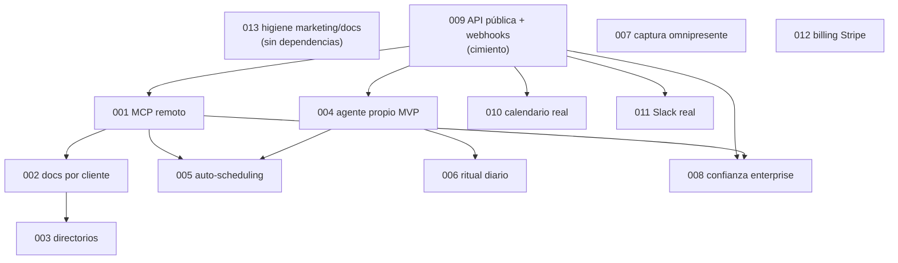

# Roadmap ejecutable: Ordo, la mejor app del mundo

> **Última actualización**: 2026-10-18
> **Autor/Mantenedor**: equipo Ordo
> **Estado**: 🚧 En desarrollo

## 📋 Índice rápido

- [Cómo leer este roadmap](#cómo-leer-este-roadmap)
- [Fases y dependencias](#fases-y-dependencias)
- [Milestones de GitHub](#milestones-de-github)
- [Tabla ODD ↔ issue ↔ milestone](#tabla-odd--issue--milestone)
- [Reglas de ejecución](#reglas-de-ejecución)
- [Referencias](#referencias)

---

## Cómo leer este roadmap

- Cada fila es un **ODD doc** en [`odd/tasks/`](../../odd/tasks/): specs `S#` autoritativas, superficies de edición exactas, comandos de verificación exactos.
- **Agentes**: no trabajes desde este roadmap; trabaja desde el ODD doc (léelo hasta `## Log`) + el issue linkeado. Este archivo solo ordena y mapea.
- **Issues**: una issue por ODD doc, con el área de documentación identificada en el cuerpo. Números en la tabla de abajo.

## Fases y dependencias

| Fase | Meta | Docs | Se puede paralelizar |
|---|---|---|---|
| **M0 Higiene** | Marketing y docs honestos | 013 | Sí, empieza ya (sin dependencias) |
| **M1 Conectable** | Ser operable por cualquier agente | 009 → 001 → 002 → 003 | 009 primero; 001 tras 009; 002 tras 001; 003 tras 001+002 |
| **M2 Imbatible a diario** | Igualar/superar Todoist/Slack/Calendar | 007, 010, 011 | Tras 009 (reutilizan OAuth/patrones); entre sí en paralelo |
| **M3 Inteligente** | Agente propio + sistema proactivo | 004, 005, 006 | 004 tras 009; 005 tras 001+004; 006 tras 004 |
| **M4 Confianza + ingresos** | Enterprise + cobro real | 008, 012 | 008 tras 009+001; 012 independiente (recomendado tras M2) |

Notas:

- 007 (captura) puede empezar en paralelo a M1: toca `ai/parse-task` (extensión compatible) + UIs.
- 012 (billing) es independiente en código; va en M4 por prioridad de negocio, no por dependencia técnica.
- 003 (directorios) incluye aprobaciones externas: si un directorio tarda, su tarea se marca `blocked` con condición de desbloqueo (no bloquea el resto).

## Milestones de GitHub

| Milestone | Contiene | Criterio de cierre |
|---|---|---|
| M0 Higiene | 013 | Auditoría `promises-audit.md` en verde: cero afirmaciones falsas |
| M1 Conectable | 009, 001, 002, 003 | Un agente externo opera Ordo end-to-end con OAuth 1-click |
| M2 Imbatible a diario | 007, 010, 011 | Captura <10s, calendario bidireccional, Slack profundo |
| M3 Inteligente | 004, 005, 006 | Agente propio + scheduling + ritual funcionando |
| M4 Confianza + ingresos | 008, 012 | SSO, política honesta, cobro real con planes enforced |

## Tabla ODD ↔ issue ↔ milestone

| ODD doc | Issue | Milestone | Título |
|---|---|---|---|
| `odd/tasks/009-public-api-webhooks.md` | #229 | M1 Conectable | [FEATURE] API pública v1 + webhooks salientes |
| `odd/tasks/001-mcp-server.md` | #230 | M1 Conectable | [FEATURE] Servidor MCP remoto OAuth-first |
| `odd/tasks/002-client-integration-docs.md` | #231 | M1 Conectable | [TASK] Docs de integración por cliente (1-click + manual) |
| `odd/tasks/003-directory-listings.md` | #232 | M1 Conectable | [FEATURE] Listado en directorios (ChatGPT, Claude, ClawHub, Zapier) |
| `odd/tasks/007-omnipresent-capture.md` | #236 | M2 Imbatible a diario | [FEATURE] Captura omnipresente + paleta Cmd+K + atajos unificados |
| `odd/tasks/010-calendar-sync.md` | #238 | M2 Imbatible a diario | [FEATURE] Sync calendario bidireccional real (Google + Outlook) |
| `odd/tasks/011-slack-integration.md` | #239 | M2 Imbatible a diario | [FEATURE] Integración Slack profunda |
| `odd/tasks/004-own-agent-mvp.md` | #233 | M3 Inteligente | [FEATURE] Agente propio MVP (Q&A con retrieval + acciones + jobs) |
| `odd/tasks/005-auto-scheduling.md` | #234 | M3 Inteligente | [FEATURE] Auto-scheduling (Do Date vs Due Date + replanificación) |
| `odd/tasks/006-daily-ritual.md` | #235 | M3 Inteligente | [FEATURE] Ritual diario guiado (mañana + cierre) |
| `odd/tasks/008-enterprise-trust.md` | #237 | M4 Confianza + ingresos | [FEATURE] Confianza enterprise (SSO, política de datos, admin) |
| `odd/tasks/012-billing-stripe.md` | #240 | M4 Confianza + ingresos | [FEATURE] Facturación real con Stripe + planes enforced |
| `odd/tasks/013-marketing-docs-cleanup.md` | #241 | M0 Higiene | [TASK] Limpieza marketing/docs: cero promesas falsas |
| `odd/tasks/014-pomodoro-engine.md` | #282 | M0 Higiene | [FIX] Motor Pomodoro unificado (un solo motor, contador y reloj) |
| `odd/tasks/015-phase-persistence.md` | #300 | M0 Higiene | [FIX] Persistencia de fase Pomodoro (el turno sobrevive al restart) |
| `odd/tasks/016-skip-no-credit.md` | (crear) | M0 Higiene | [FIX] Skip sin crédito antifraude (abandonar <80% no acredita) |

## Reglas de ejecución

1. **El ODD doc manda**: sus `## Specs` son autoritativos sobre cualquier resumen (handoff, issue, chat). Ante conflicto, gana el ODD doc; si el ODD doc está mal, se corrige el ODD doc (con entrada en `## Log`), no se improvisa.
2. **Sin ODD doc, no hay implementación**: si el trabajo no tiene doc en `odd/tasks/`, no está aprobado. Crear el doc primero (humano u orquestador).
3. **Unidades pequeñas**: work-unit commits, PRs ≤300 líneas ideal (`CONTRIBUTING.md`), slices encadenados si >400 (`chained-pr`).
4. **Tests primero** para cambios de comportamiento (RED/GREEN/PRESERVE); excepción justificada solo para docs/cambios no testeables.
5. **Evidencia, no afirmaciones**: cada tarea cierra con comando exacto + resultado observado.
6. **Hallazgos ≠ alcance**: un hallazgo durante el trabajo se reporta; nunca expande el alcance solo.

## 📚 Referencias

- [Visión](../vision/product-vision.md) · [Competencia](../vision/competitive-analysis.md) · [Agent-first](../vision/agent-first-strategy.md) · [Auditoría](../vision/promises-audit.md)
- [Tareas ODD](../../odd/tasks/) · [Cómo trabajar con ODD](../../odd/README.md)
